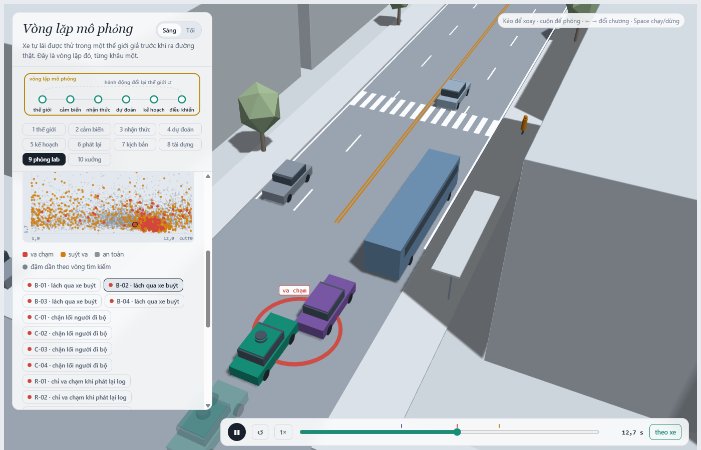
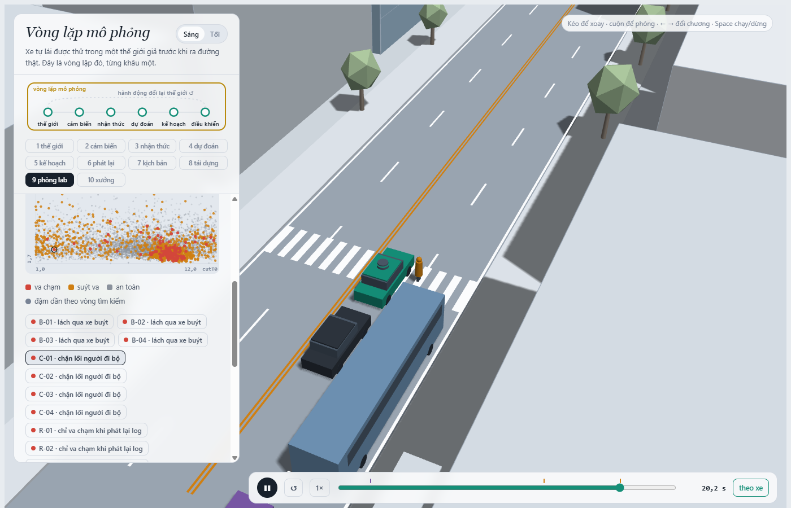
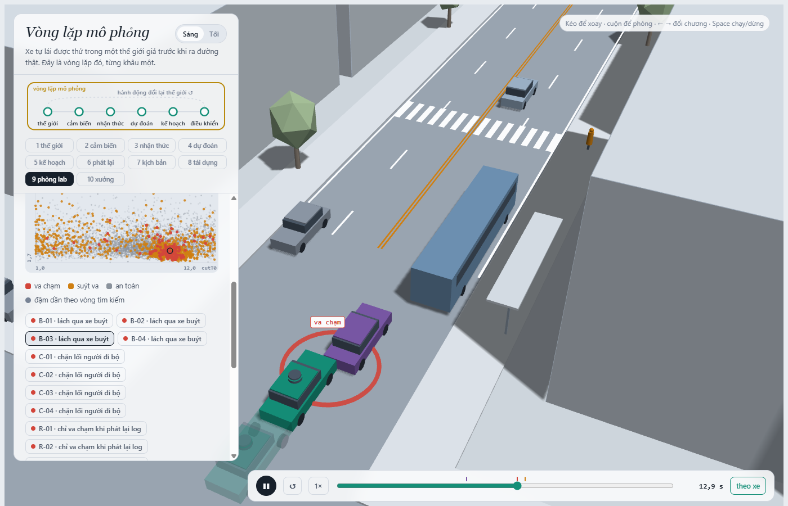
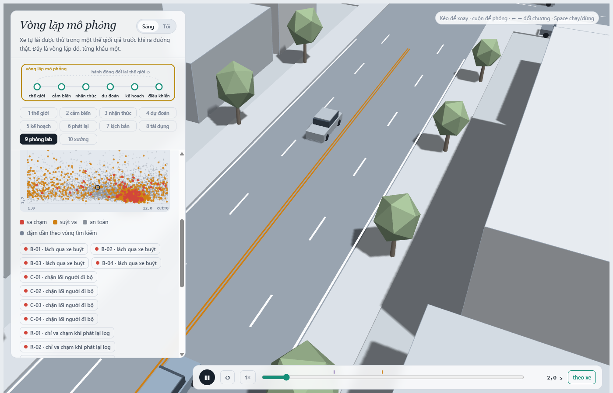

MSSV: 202602666

# Lab 11 · Scenario Forge — báo cáo

Thị trấn B (`evidence/meta.json: _run.town`). Mọi kết quả dưới đây lấy từ `evidence/` với ngân sách chuẩn (`_run.quick = false`). Xác suất chỉ thuộc thế giới mô phỏng và các phân phối giả định của lab.

## 1. Phát lại log có trung thực không?

`replay.json`: 400 cảnh; bỏ 1 log vì người lái cũng va chạm, còn 399. Planner trên log phát lại có 118 thất bại: 106 `rear`, 12 `side`; trong thế giới phản ứng có 1 `side`, 0 `rear`, và không có ca trùng giữa hai cách chạy (`crash_in_both = 0`). Ở cảnh `replay_only[scenario = 6]`, loại tiếp xúc là `rear`, còn TTC nhỏ nhất khi thế giới phản ứng là 2,56 s. Planner phanh khác người lái trong log, nhưng xe bám đuôi ở bản phát lại vẫn chạy theo quỹ đạo cũ, không biết xe trước phanh sớm. Trong thế giới phản ứng, xe sau điều chỉnh tốc độ. Vì vậy phần lớn vụ đâm đuôi trên log là phản thực sai, không được cộng vào xác suất va chạm thật của planner.

## 2. Kịch bản bất khả thi

`is_feasible` loại cảnh nếu gia tốc ngang cực đại của chuyển làn cosine `3,5π²/(2·cutDur²)` vượt `μg`; nếu `cutBrake > μg`; nếu `pedV > 2,5 m/s`; hoặc nếu `cutV` không thuộc `(0, 22] m/s`. Hai luật đầu là giới hạn bám đường và phanh; hai luật sau tránh người đi bộ chạy quá nhanh và xe chuyển làn dừng hẳn hoặc vượt tốc độ của cảnh này. `hunt.json`: `crosswalk_block` có 12 mẫu bất khả thi, nhiều nhất; các cuộc săn còn lại lần lượt `bus_bypass` 4, `cut_in` 1, `rear_ended` 4. CEM bị hút về các cực trị cho điểm nguy hiểm cao, kể cả chuyển làn quá gắt trên mặt đường ướt. Đếm các mẫu đó là thất bại sẽ thổi phồng xác suất của một thế giới có hành vi vi phạm vật lý.

## 3. Monte Carlo cho biết gì?

`mc.json`: 4 thất bại trong 3.000 lần, `p = 0,001333`; Wilson 95% `[0,0005186; 0,0034235]`; 14 cảnh bất khả thi không được tính là thất bại. Cần xấp xỉ `1,96²/(0,2²·p) ≈ 72.000` lần để sai số 95% khoảng ±20% của `p`, lớn hơn 24 lần ngân sách 3.000. Bốn ca đều là `bus_bypass`. `cut_in`, `crosswalk_block`, `rear_ended`, `other` chưa xuất hiện: từng kiểu có cận trên Wilson `0,001279`, không thể kết luận xác suất bằng 0.

## 4. Importance sampling, ESS và độ suy biến

`estimate.json: seeds[*].per` (mỗi kiểu dùng 600 mẫu IS/seed):

| Kiểu | Seed | p | Hits | ESS | Top share |
|---|---:|---:|---:|---:|---:|
| bus_bypass | 0 | 9,604×10⁻⁴ | 59 | 132,3 | 0,730 |
| bus_bypass | 1 | 5,038×10⁻⁴ | 70 | 124,4 | 0,216 |
| bus_bypass | 2 | 5,099×10⁻⁴ | 54 | 115,5 | 0,186 |
| cut_in | 0 | 0 quan sát (cận trên 0,025) | 0 | 125,5 | 0 |
| cut_in | 1 | 0 quan sát (cận trên 0,025) | 0 | 118,6 | 0 |
| cut_in | 2 | 0 quan sát (cận trên 0,025) | 0 | 117,1 | 0 |
| crosswalk_block | 0 | 1,166×10⁻⁶ | 67 | 113,1 | 0,412 |
| crosswalk_block | 1 | 3,945×10⁻⁷ | 81 | 120,0 | 0,207 |
| crosswalk_block | 2 | 7,918×10⁻⁷ | 91 | 126,8 | 0,482 |
| rear_ended | 0 | 0 quan sát (cận trên 0,025) | 0 | 124,7 | 0 |
| rear_ended | 1 | 0 quan sát (cận trên 0,025) | 0 | 126,3 | 0 |
| rear_ended | 2 | 0 quan sát (cận trên 0,025) | 0 | 121,1 | 0 |

Tổng ba seed là `9,615×10⁻⁴`, `5,042×10⁻⁴`, `5,107×10⁻⁴` (`estimate.json: seeds[*].total`); trung vị nhỏ hơn Monte Carlo `0,001333` khoảng 2,6 lần, nhưng nằm trong khoảng Wilson rộng của MC. Seed 0 của `bus_bypass` có `top_share = 0,730`: một mẫu mang 73% ước lượng nên số đó dễ dao động, dù số hits cao. Các kiểu 0 hits có `upper_zero_hits = 0,025` theo hỗn hợp phòng thủ `β=0,2`, chứ không có xác suất 0. `other` lấy từ MC: `k=0/3000`, `p=0`, cận trên Wilson `0,001279`; không săn vì đó là phần dư của các kiểu đã định nghĩa. Tổng ngân sách săn và IS là 16.800 lần (`estimate.json: budget`), khoảng 4,3 lần ít hơn ~72.000 lần MC cần theo xấp xỉ ở câu 3, nhưng IS ở đây vẫn chưa ổn định giữa các seed; khoảng ±1,96 SE chỉ là xấp xỉ.

## 5. Các kiểu thất bại

`hunt.json: found`: cuộc săn riêng `bus_bypass` tìm 164 ca đúng kiểu; cuộc săn `crosswalk_block` tìm 38. Cuộc săn `cut_in` chỉ gặp 19 ca `bus_bypass`, còn cuộc săn `rear_ended` chỉ gặp 6 ca `crosswalk_block`. Không tìm thấy kiểu mục tiêu trong 2.400 mẫu săn không chứng minh kiểu đó không tồn tại; MC cũng không thấy và cận trên IS khi 0 hits còn 0,025. Nếu gộp thành một điểm nguy hiểm chung, CEM dễ tập trung vào lách xe buýt và bỏ lỡ chặn lối người đi bộ.

`B-02`: C2 lách qua xe buýt đang dừng; xe ta đuổi tới lúc C2 chậm trong hành lang sát xe buýt và tiếp xúc. Vòng đỏ đánh dấu va chạm.

`C-01`: P1 bước ra từ vùng bị xe buýt che; xe ta phanh và dừng với thân nằm trên vạch, khiến P1 phải chờ. Đây là `block`, không phải thân xe chạm người đi bộ.

## 6. Sửa planner, kiểm tra trên TEST

`fix.json`: chọn `{"cutinLat": 3.0}` theo TRAIN. TRAIN: `fail = 3,027×10⁻⁷`, `fail_hi = 5,394×10⁻⁷`, `progress = 217,51 m`, `harsh = 7,78` khung/lần; `bus_bypass` bị đánh dấu `unseen`, nên cận TRAIN chỉ là sàng lọc. Baseline TRAIN: `fail = 5,449×10⁻⁴`, `fail_hi = 9,101×10⁻⁴`, `progress = 217,42 m`, `harsh = 8,51`.

| TEST (`fix.json`) | fail | fail_hi_seen | fail_hi hợp lệ | Quãng đường | Khung phanh gấp |
|---|---:|---:|---:|---:|---:|
| Bản sửa | 9,129×10⁻⁸ | 1,865×10⁻⁷ | 0,038779 | 213,82 m | 8,24 |
| Gốc | 0,001470 | 0,002686 | 0,003965 | 214,05 m | 8,69 |

Bản sửa đi ngắn hơn khoảng 0,11%, dưới giới hạn 5%. `fail_hi` của bản sửa lớn hơn `fail` của policy gốc vì TEST không thấy `bus_bypass` trong 400 mẫu của kiểu đó: cận không thấy ca là `3/(0,2·400)=0,0375`, cộng thêm cận cho các va chạm khác từ 3.000 mẫu tự nhiên. Đó là thiếu độ chính xác thống kê, không chứng minh bản sửa nguy hiểm hơn. Ảnh `B-03` dưới đây cho thấy va chạm của policy gốc; xe mờ là policy `cutinLat=3.0` trên đúng cảnh đó và tránh được va chạm.

Tăng khoảng cách theo thời gian `T` nghe có vẻ thận trọng, nhưng ứng viên `T=2.0` cho `fail_hi` TRAIN `0,005241`, cao hơn baseline `0,000910` (`fix.json: table`, `baseline_train`). Xe ta giảm/đổi tốc sớm hơn, làm khe mà C2 thấy và thời điểm lách xe buýt thay đổi; thế giới phản ứng lại policy. Bảng TRAIN ghi `bus_bypass.p` tăng từ `5,446×10⁻⁴` lên `0,002229`, nên không thể xem mỗi núm theo hướng “thận trọng hơn” một cách độc lập.

## 7. Từ mô phỏng ra đường thật

1. `space.py` đặt trung vị khe chấp nhận của xe chuyển làn ở thị trấn B là 12 m. Cần quỹ đạo camera ven đường hoặc log đội xe ở chỗ nhập làn để đo phân bố khe thật. Nếu khe thật nhỏ hơn, C2 cắt sát hơn và ước lượng lỗi lách/cắt làn hiện tại có thể thấp.
2. `space.py` cho 85% người đi bộ ngó qua xe buýt (`pedLook`). Cần video vạch qua đường có xe lớn che tầm nhìn, gắn nhãn nhìn/ngừng/bước và khoảng cách xe. Nếu người thật ít ngó hơn, mô hình có thể dự đoán sai thời điểm xuất hiện P1 và đánh giá thấp rủi ro chặn vạch; hướng sai lệch cần kiểm tra bằng dữ liệu.
3. Thị trấn B đặt xác suất đường ướt 30%, với `μ=0,5` thay vì `0,8`. Cần log mưa theo tuyến kết hợp đo độ bám mặt đường và gia tốc phanh. Nếu thực tế ướt nhiều hơn hoặc `μ` thấp hơn, khoảng dừng sẽ dài hơn; xác suất lỗi do phanh muộn hiện báo có thể thấp.

## 8. Giới hạn

Con số này chỉ cho một phố, 24 s và các tác nhân cố định của `avsim`; không bao gồm nút giao lạ, xe máy hay công trường. Xe khác dùng IDM/gap acceptance đã lập trình, trong khi người thật có phân bố phản ứng khác và có thể cố ý nhường hoặc chen. Cảm biến gần như hoàn hảo ngoài vùng xe buýt che, nên lỗi phát hiện, định vị và dự báo không được đo. Nếu có thêm một tuần, tôi sẽ gắn nhãn quỹ đạo và mức che khuất từ video/log thật theo các tình huống này, hiệu chuẩn ba phân phối ở câu 7, rồi chạy kiểm định ngoài mẫu với nhiều seed và ngân sách đủ để thu hẹp cận của kiểu chưa thấy.

## 9. Rắc rối của tôi

`hazard.json`: xe dẫn L1 phanh khẩn cấp khi xe ta ở cách 18–42 m, với giảm tốc 3,5–6 m/s² trong 1–3 s; cảnh chính dùng `trig=40 m`, `decel=5,5 m/s²`. Giả thuyết là planner IDM có thể phản ứng chậm với thay đổi đột ngột của xe trước. Dải được quét dưới giới hạn `μg`; `mine.json: accepted = 1294/1500 = 86,27%`. Nguồn và phép tính `exposure = 0,00014` mỗi lượt ở `hazard.json: why`: nghiên cứu [LongROAD](https://pmc.ncbi.nlm.nih.gov/articles/PMC8005989/) đo 1,16 phanh mạnh/1.000 dặm; dùng 189 m/lượt từ `world.json` rồi làm tròn. Đây là proxy cho *mọi* phanh mạnh, chưa phải tần suất xe dẫn phanh trước xe ta nên cần hiệu chuẩn thực địa.

| `mine.json` trên 1.294 cảnh khả thi | Gốc | `cutinLat=3.0` |
|---|---:|---:|
| Tổng va chạm xe ta | 3 | 0 |
| Avoidable khi thấy rồi phanh tối đa | 0 | 0 |
| Unavoidable | 0 | 0 |
| Unattributed | 3 | 0 |
| Low speed (<1 m/s, nằm trong các nhóm trên) | 0 | 0 |
| P(lỗi planner \| rắc rối), Wilson 95% | 0 quan sát; `[0; 0,002960]` | 0 quan sát; `[0; 0,002960]` |
| Cận tần suất mỗi lượt sau nhân exposure | `4,144×10⁻⁷` | `4,144×10⁻⁷` |

`mine.json: exact.planner=[]`: cảnh chính không va chạm. Ba va chạm của policy gốc ở các cảnh quét là `unattributed`, không được đếm là lỗi do phanh gấp. Không có bằng chứng rằng rắc rối này làm planner thất bại trong ngân sách trên; cận trên 0,002960 vẫn khá rộng. Tần suất lách xe buýt IS trung vị khoảng `5,04×10⁻⁴` mỗi lượt (`estimate.json`), còn cận cho lỗi có điều kiện trên rắc rối sau nhân exposure là `4,144×10⁻⁷` mỗi lượt; phép so chỉ mang tính thăm dò do exposure là proxy khác nguồn. Tôi chưa tự lái cảnh này, nên không suy diễn kết quả người lái.

`avoidable` dùng người phanh tối đa từ khung đầu tiên rắc rối đã xảy ra **và** nhìn thấy, nên lạc quan vì biết chính xác thời điểm và luôn dùng hết độ bám; nó có thể đếm nhiều hơn số lỗi một planner thật tránh được. Đồng thời oracle chỉ thử phanh, không thử đánh lái, nên có thể bỏ sót ca tránh được bằng điều khiển khác. Với kết quả hiện tại, chưa có căn cứ chọn thêm núm chỉnh chỉ để sửa rắc rối này. Bước tiếp theo hợp lý là thêm logic theo dõi giảm tốc đột ngột của xe dẫn và kích hoạt phanh khẩn cấp theo TTC/khoảng dừng phụ thuộc `μ`, rồi đánh giá bằng nhiều cảnh có rắc rối đã thực sự kích hoạt và kiểm định ngoài mẫu.
